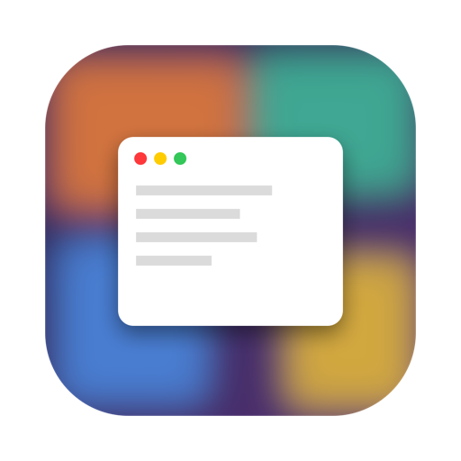
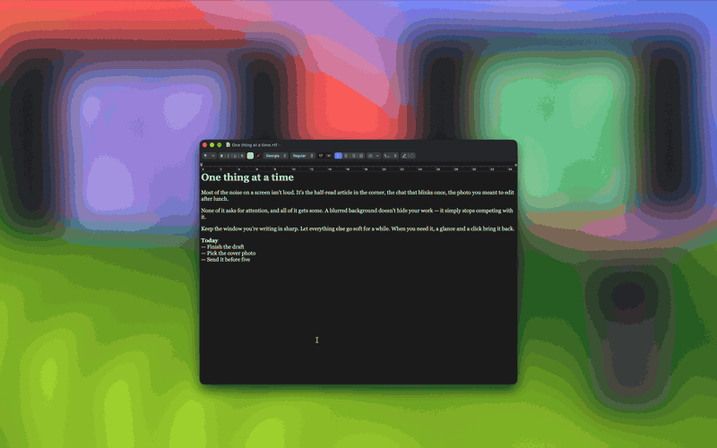

<p align="center"></p>

<h1 align="center">Veil</h1>

<p align="center">
  Keep the window you're working in sharp. Softly blur everything behind it.<br>
  A free, open-source macOS menu-bar app.
</p>

<p align="center">
  <a href="https://github.com/iamzifei/veil/releases/latest/download/Veil.dmg"><b>Download Veil.dmg</b></a> ·
  <a href="https://jamesai.dev/veil/"><b>Try it in your browser</b></a> ·
  <a href="README.zh-CN.md">中文</a>
</p>

<p align="center">
  <a href="https://jamesai.dev/veil/"></a><br>
  <sub>▶ <a href="docs/assets/veil-demo.mp4">Full-quality video (MP4)</a> · or <a href="https://jamesai.dev/veil/">play with it live</a> on the website</sub>
</p>

## What it does

Your Mac shows every window at full volume. Veil turns the background down: the window you're using stays crisp, and everything behind it fades into a soft blur, so your eyes stop wandering.

- **Ambient and Deep modes.** A light, airy blur, or a darker, heavier one when you really need to focus.
- **Your look.** Blur radius (0 = blur-free mode that only dims), tint (presets, your system accent, or any colour) with strength, film grain, monochrome.
- **Focus rules.** *App Groups* treat several apps as one focus (say, an editor plus a browser). *App-wide focus* keeps every window of the front app sharp. An *ignore list* switches Veil off for apps like video players.
- **Multiple displays.** *Per screen* keeps the frontmost window on each display sharp; *Global* only the one you're using.
- **Gestures.** Shake the mouse to toggle. Hold ⇧ and shake to peek behind the veil (it stays at least 2 s and holds while you keep ⇧ down). Push the pointer into a screen corner to peek. Veil steps aside while you drag a file.
- **Transitions.** Fade, Cursor reveal (a circle opens from your pointer), or None.
- **Tidy desktop.** Optionally auto-hide the menu bar and Dock while Veil is on. The Stage Manager strip stays visible (or blur it too).
- **Automation.** A `veil://` URL scheme for Shell, AppleScript and Shortcuts.

## Shortcuts

| Action | Default |
|---|---|
| Toggle Veil | ⌃⌥⌘F |
| Switch mode (Ambient ↔ Deep) | ⌃⌥⌘M |
| Ignore the current app | ⌃⌥⌘E |
| Open controls | ⌃⌥⌘C |

All four can be re-recorded in the controls window. Left-click the menu-bar icon to toggle (or to open the controls, your choice). Right-click it for the menu.

## Automation

```sh
open -g veil://toggle            # also: on, off, peek, settings, ignore
open -g veil://mode/deep         # ambient | deep | toggle
open -g "veil://set?blur=30&tint=blue&tintAmount=0.3&grain=0.4&monochrome=1&transition=cursor"
```

`set` accepts `blur` (0–60), `tint` (preset name or `#RRGGBB`), `tintAmount` (0–0.8), `grain` (0–1), `monochrome` (0–1), `mode`, `display` (`perScreen` / `global`), `appwide`, `blurStageManager`, `autohide` (`on` / `off`), and `transition` (`fade` / `cursor` / `none`). Use `open -g` so Veil doesn't steal focus.

## Install

1. Download [Veil.dmg](https://github.com/iamzifei/veil/releases/latest/download/Veil.dmg), open it, and drag **Veil** to Applications.
2. Launch it. Veil lives in the menu bar; there is no Dock icon.

Requires macOS 14 Sonoma or later. Universal binary (Apple Silicon + Intel).

**Permissions.** None for blurring: Veil reads window positions, which needs no permission, and it never records your screen. Auto-hiding the menu bar and Dock asks for *Automation → System Events* the first time you turn it on.

Signed with a Developer ID and notarized by Apple. Updates install automatically (Sparkle).

## Build from source

```sh
git clone https://github.com/iamzifei/veil && cd veil
scripts/build.sh            # builds, ad-hoc signs, installs to /Applications
scripts/build.sh release    # Developer ID signing + DMG (maintainers)
```

Swift 5.9+. The only dependency is [Sparkle](https://sparkle-project.org) for automatic updates.

## How it works

Each display gets a borderless overlay window that is ordered **directly below the focused window**, so everything above it stays sharp and everything below it is blurred by the window server itself (a `CABackdropLayer` with a Gaussian-blur filter, a tint layer and a grain layer). Windows that must stay sharp but sit lower in the stack (App Groups, App-wide focus, the Stage Manager strip) are cut out of the overlay with a mask. Focus is tracked by polling `CGWindowListCopyWindowInfo` ten times a second; that needs no permission and catches window switches no notification reports.

## License

[MIT](LICENSE) © 2026 Zifei Gong · made by [James](https://jamesai.dev)

## More Mac apps by James

| App | What it does | GitHub |
|---|---|---|
| [Candela](https://getcandela.app) | Every display control macOS hides | [iamzifei/Candela](https://github.com/iamzifei/Candela) |
| [ClipStack](https://getclipstack.app) | Clipboard history in the menu bar | [iamzifei/clipstack](https://github.com/iamzifei/clipstack) |
| [AudioSwitch](https://audioswitch.dev) | Audio device switching from the menu bar | [iamzifei/audioswitch](https://github.com/iamzifei/audioswitch) |
| [Inkstone](https://inkslab.app) | Notes that stay your own files | [iamzifei/inkstone](https://github.com/iamzifei/inkstone) |
| [Tapper](https://jamesai.dev/tapper/) | Turns your pointer into a cartoon glove on a long stick, for demos and screen recordings. Free, MIT. | [iamzifei/tapper](https://github.com/iamzifei/tapper) |
