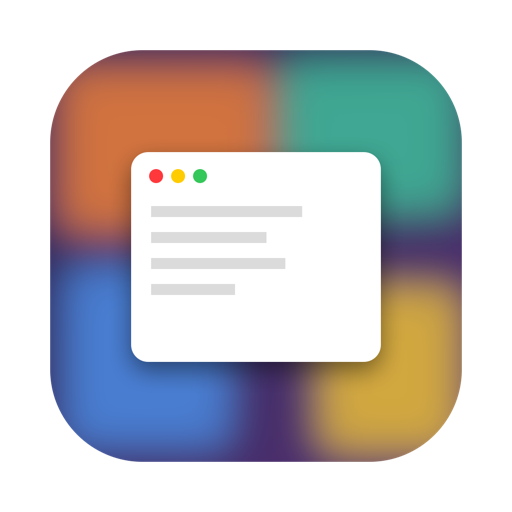
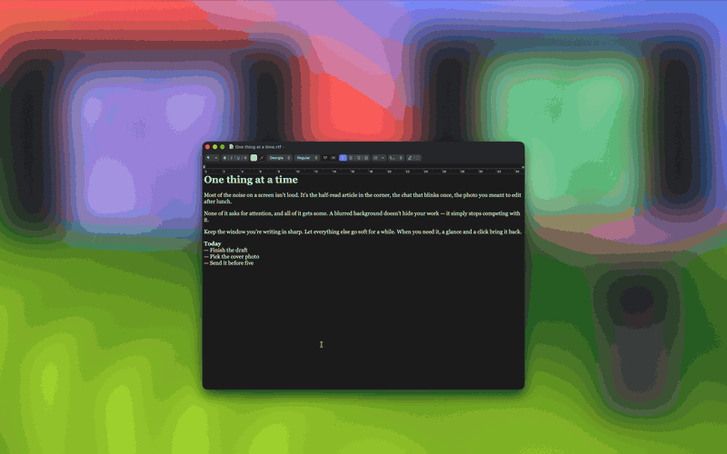

<p align="center"></p>

<h1 align="center">Veil</h1>

<p align="center">
  你正在用的窗口保持清晰，后面的一切柔和地模糊掉。<br>
  免费、开源的 macOS 菜单栏小工具。
</p>

<p align="center">
  <a href="https://github.com/iamzifei/veil/releases/latest/download/Veil.dmg"><b>下载 Veil.dmg</b></a> ·
  <a href="https://jamesai.dev/veil/"><b>在浏览器里直接试</b></a> ·
  <a href="README.md">English</a>
</p>

<p align="center">
  <a href="https://jamesai.dev/veil/"></a><br>
  <sub>▶ <a href="docs/assets/veil-demo.mp4">高清视频（MP4）</a> · 或到 <a href="https://jamesai.dev/veil/">官网</a> 上直接动手试</sub>
</p>

## 它做什么

Mac 上每个窗口都在抢你的注意力。Veil 把背景调低：手上这个窗口清清楚楚，后面的全部变成柔和的模糊，眼睛就不会到处乱跑。

- **深度 / 氛围两种模式**：深度模式把窗口后面的一切均匀模糊；氛围模式让屏幕上方保持清晰，越往中间越模糊。
- **控制中心式的设置面板**：点菜单栏图标，屏幕右侧出现一块毛玻璃面板。最上面是忽略当前 App、电源、模式，以及模糊、色调、颗粒三个滑杆；其余选项在「更多设置」里。
- **外观随你调**：模糊强度（调到 0 就不模糊，只留色调、颗粒或黑白）、色调（跟随系统、九种预设或任意颜色，浓度可调）、胶片颗粒、黑白。
- **焦点规则**：*App Groups* 让几个 App 共用一个焦点（比如编辑器 + 浏览器）；*整个 App* 模式让前台 App 的所有窗口都保持清晰；*忽略名单* 里的 App（比如视频播放器）不会被盖住。
- **多显示器**：*Per screen* 每块屏各自保留最前面的窗口；*Global* 只保留你正在用的那个。
- **手势**：晃动鼠标开关；按住 ⇧ 晃动 = 临时看一眼（至少 2 秒，按住 ⇧ 就一直保持）；把指针推进屏幕角落也能临时看一眼；拖文件时自动让开。
- **过渡效果**：淡入淡出（0–1.5 秒，默认 0.75 秒），或者从指针位置扩散开的柔和圆圈。切换窗口时，新窗口立刻清晰，旧窗口慢慢糊回去。
- **桌面更干净**：开着 Veil 时可以自动隐藏菜单栏、Dock 或两者；台前调度的侧边窗口条保持可见（也可以一起模糊）。
- **自动化**：`veil://` 地址，Shell、AppleScript、快捷指令都能调；设置面板里列出了全部命令，点一下就能复制。

## 快捷键

| 操作 | 默认 |
|---|---|
| 开关 Veil | ⌃⌥⌘F |
| 切换模式（氛围 ↔ 深度） | ⌃⌥⌘M |
| 忽略当前 App | ⌃⌥⌘E |
| 打开设置面板 | ⌃⌥⌘C |

四个都能在设置面板里重新录（更多设置 → 快捷键）。左键点菜单栏图标 = 打开设置面板（也可改成开关），右键出菜单。图标会显示状态：发光的圆点是深度模式，柔和的圆点是氛围模式，空心圆环表示当前 App 已被忽略，淡淡的圆点表示已关闭。

## 自动化

```sh
open -g veil://toggle                 # 还有 on, off, peek, settings, check-updates, quit
open -g veil://mode/ambient           # ambient | deep | toggle
open -g veil://blur/60                # 0–100
open -g veil://tint/color/blue        # 预设名或 RRGGBB
open -g veil://tint/opacity/30        # 0–100
open -g veil://grayscale/toggle       # on | off | toggle | 0–100
open -g veil://ignore/toggle          # 忽略 / 恢复当前 App
```

参数说明见 [英文 README](README.md#automation)。用 `open -g` 可以不抢焦点。

## 安装

用 [Homebrew](https://brew.sh)：

```sh
brew install --cask iamzifei/tap/veil
```

或者手动安装：

1. 下载 [Veil.dmg](https://github.com/iamzifei/veil/releases/latest/download/Veil.dmg)，打开后把 **Veil** 拖进「应用程序」。
2. 打开它。Veil 只在菜单栏里，没有 Dock 图标。

需要 macOS 14 或更新版本，Apple 芯片和 Intel 都支持。

**权限**：模糊本身不需要任何权限。Veil 只读取窗口位置，不录屏。只有第一次打开「自动隐藏菜单栏和 Dock」时，会请求「自动化 → System Events」权限。

已用 Developer ID 签名，并通过 Apple 公证。更新会自动安装（Sparkle）。

## 从源码构建

```sh
git clone https://github.com/iamzifei/veil && cd veil
scripts/build.sh
```

Swift 5.9+，唯一的第三方依赖是自动更新用的 [Sparkle](https://sparkle-project.org)。

## 许可

[MIT](LICENSE) © 2026 Zifei Gong · 作者 [James](https://jamesai.dev)

## James 的其他 Mac 应用

| 应用 | 简介 | GitHub |
|---|---|---|
| [Candela](https://getcandela.app) | macOS 藏起来的显示器控制 | [iamzifei/Candela](https://github.com/iamzifei/Candela) |
| [ClipStack](https://getclipstack.app) | 菜单栏剪贴板历史 | [iamzifei/clipstack](https://github.com/iamzifei/clipstack) |
| [AudioSwitch](https://audioswitch.dev) | 菜单栏音频设备切换 | [iamzifei/audioswitch](https://github.com/iamzifei/audioswitch) |
| [Inkstone](https://inkslab.app) | 笔记就是你自己的文件 | [iamzifei/inkstone](https://github.com/iamzifei/inkstone) |
| [敲黑板 Tapper](https://jamesai.dev/tapper/) | 把鼠标指针变成长杆上的卡通手套，演示和录屏时一眼看清你指哪儿。免费，MIT 开源。 | [iamzifei/tapper](https://github.com/iamzifei/tapper) |
